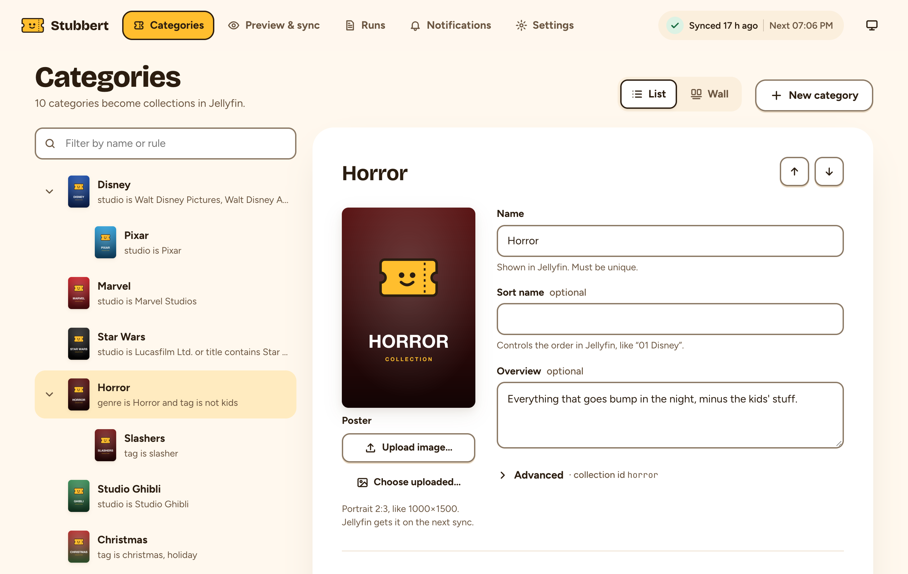
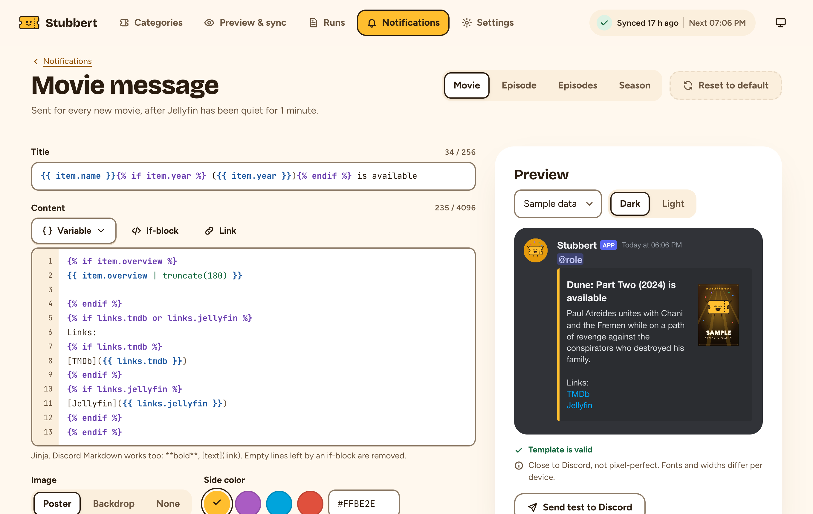

<p align="center">
  
</p>

<h1 align="center">Stubbert</h1>

<p align="center">
  <b>The friendly usher for your Jellyfin library.</b><br>
  Shows every title to the right category, tells Discord when something new is playing, and keeps upgrades out of
  Recently added.
</p>

<p align="center">
  
  
</p>

---

Stubbert does three things for your Jellyfin server:

- **Categories:** it sorts your movies and series into categories such as *Disney*, *Marvel* or *Horror*, using
  rules you set, in their own **Categories** library in every Jellyfin app.
- **Notifications:** it posts new movies and episodes to Discord, and stays quiet about upgrades and big imports.
- **Recently added:** it keeps quality upgrades from showing up as new in Jellyfin's *Recently added*.

<p align="center">
  <picture>
    <source media="(prefers-color-scheme: dark)" srcset="docs/images/screenshot-categories-dark.png">
    
  </picture>
</p>

<p align="center">
  <picture>
    <source media="(prefers-color-scheme: dark)" srcset="docs/images/screenshot-notifications-dark.png">
    
  </picture>
</p>

## Features

### 🎟️ Categories

- **Categories as a library.** A *Categories* tile next to Movies and Shows in every Jellyfin app, with only your
  categories in it. They stay out of the normal Collections tab.
- **Rules, not hand-picking.** Match on genre, studio, tag or title (contains, exact or regex). Combine rules with
  *any* or *all*, or exclude matches. New movies and series join the right categories on their own.
- **Sub-categories.** Nest *Pixar* inside *Disney*, or *Slashers* inside *Horror*.
- **Your own posters**, names, sort order and descriptions per category.
- **Preview before anything changes.** See per category which titles would be added or removed, then sync by hand,
  on a schedule or as soon as new items arrive.
- **Safety guards.** A category that would suddenly lose all or more than half of its items is skipped, so a broken
  rule or a bad fetch can't empty it.
- **Leaves your media alone.** It never writes tags or metadata to your movies and series. It only touches the
  collections it manages.

### 🔔 Discord notifications

- **One tidy message** per new movie, episode or whole season, with the poster and a link to Jellyfin.
- **Quiet about the rest.** Quality upgrades, rescans and big imports don't post anything. Setup can mark what's
  already in your library, so its first upgrade doesn't look new either.
- **Your own messages.** Every message is a template you can edit, with a live preview in Discord style.
- **Batched and reliable.** New items are gathered until things have been quiet for a few minutes, so a season
  arrives as one message. Failed messages are retried, and held until you replace a deleted Discord webhook.

### 🆕 Recently added without upgrades

- **Upgrades keep their date.** When Radarr or Sonarr swaps in a better file, Jellyfin sees a new item and puts it
  on top of *Recently added*. The plugin gives it back the date the title was first added.
- **New episodes still count.** Each episode is tracked on its own, so a new episode of an old show still shows up.
- **Opt-in.** Off by default; turn it on under **Dashboard → Plugins → Stubbert**. It only changes the date added
  of replaced files. A title that's gone longer than 30 days (you can change this) counts as new when it comes back.

## How it works

Stubbert has two parts: **the app**, a web UI in Docker, and **the plugin**, which runs inside Jellyfin.

| Feature | The app | The plugin |
|---|---|---|
| 🎟️ Categories | You manage categories and rules. It previews changes and syncs them to Jellyfin as collections, by hand, on a schedule or when new items arrive. | Makes the *Categories* library list only your categories, and hides them from the normal Collections tab. |
| 🔔 Notifications | Receives Jellyfin's events through the [Webhook plugin](https://github.com/jellyfin/jellyfin-plugin-webhook), and posts the new titles to Discord. | — |
| 🆕 Recently added | — | Gives a replaced file the date its title was first added. |

The plugin is needed because stock Jellyfin can't do either: every collection lands in the same built-in folder, a
collections library always shows all of them, and an upgraded file always counts as newly added.

## Quick start

You need **Jellyfin 12.1 or newer** and **Docker** with Compose.

### 1. Install the plugin

In jellyfin-web, go to **Dashboard → Plugins → Repositories**, click **+** and add:

```
https://raw.githubusercontent.com/janzee22/stubbert/main/manifest.json
```

Then open the **Catalog**, install **Stubbert** and restart Jellyfin. It should show as *Active*
under **Dashboard → Plugins**.

<details>
<summary>Install by hand instead</summary>

Download the zip from the [releases](https://github.com/janzee22/stubbert/releases), unzip it into a new folder
`Stubbert_<version>/` in Jellyfin's plugin folder and restart Jellyfin.

| Jellyfin install | Plugin folder |
|---|---|
| Official Docker image | `/config/plugins/` inside the container |
| Debian/Ubuntu package | `/var/lib/jellyfin/plugins/` |

</details>

### 2. Start the app

Save this as `docker-compose.yml`:

```yaml
services:
  stubbert:
    image: ghcr.io/janzee22/stubbert:latest
    user: '1000:1000'
    ports:
      - '8080:8080'
    volumes:
      - ./data:/data
    restart: unless-stopped
    stop_grace_period: 2m
```

```sh
mkdir -p data
docker compose up -d
```

`./data` must be writable by the user in `user:`. Passwords, the Jellyfin address and other options can also come
from environment variables; see [Configuration](docs/configuration.md).

### 3. Walk through the setup

Open `http://<host>:8080` **right away**: the first visitor chooses the password. The setup then connects to
Jellyfin with an API key (**Dashboard → API Keys → +**), checks the plugin and creates the Categories library for
you. More detail in [Using Stubbert](docs/usage.md#onboarding).

That's it. Add your first category, preview, sync, and the **Categories** tile shows up in your apps.

## Documentation

| | |
|---|---|
| 📖 [Using Stubbert](docs/usage.md) | Onboarding, the editor, preview & sync, safety guards, known limits |
| 🔔 [Discord notifications](docs/notifications.md) | Setting up the Jellyfin webhook and Discord, what gets sent, templates |
| ⚙️ [Configuration](docs/configuration.md) | Environment variables, the data folder, `config.yaml`, a Streamyfin home row |
| 🩺 [Troubleshooting](docs/troubleshooting.md) | Common errors and how to fix them, and how to update |
| 📝 [Changelog](CHANGELOG.md) | What changed in each release |
| 🛠️ [Development](docs/development.md) | How the code is organised, running a dev Jellyfin, tests, releasing |

## Compatibility

The plugin is tested on **Jellyfin 12.1 and 12.2** but may work on different versions. The Categories library is a normal Jellyfin library,
so it shows up in any Jellyfin app.

## Support and license

Stubbert is a hobby project, maintained in spare time. Bug reports and ideas are welcome as
[issues](https://github.com/janzee22/stubbert/issues); security problems go through [SECURITY.md](SECURITY.md).

Licensed under the [GNU GPL v3](LICENSE).
